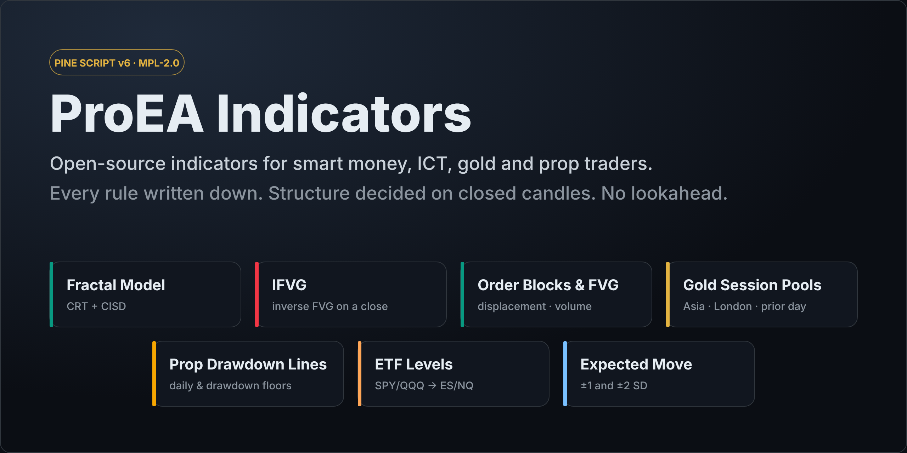

  

  
  
  
  
  

  <b>Seven TradingView indicators. Every rule written down, structure decided on closed candles, no lookahead.</b> 
  The open core of the <a href="https://proea.app/?utm_source=github&utm_medium=readme&utm_campaign=proea_indicators">ProEA</a> desks: Fractal Model (CRT + CISD), IFVG, order blocks & FVG, gold's session liquidity, prop firm drawdown floors, ETF levels on futures and expected move.

---

## Indicators

| | Indicator | What it marks | Alerts |
|:-:|---|---|---|
|  | **[Fractal Model: CRT + CISD](indicators/fractal-model)** | C1's range from the last closed higher-timeframe candle, a one-sided sweep of it, the CISD, and C2's close back inside C1 (candle range theory). | Bullish / bearish CISD, C2 back inside C1 (both sides) |
|  | **[IFVG: Inverse FVG on a Close](indicators/ifvg)** | Fair value gaps that a later candle closes through, flipped into inverse FVGs by one strict rule. A wick through the edge is no flip. | Bullish IFVG, bearish IFVG |
|  | **[Order Blocks & FVG](indicators/order-blocks-fvg)** | Smart money concepts order blocks and fair value gaps, each printed with its displacement (in ATR) and its origin candle's volume ratio. | Bullish / bearish order block, bullish / bearish FVG |
|  | **[Gold Session Pools](indicators/gold-session-pools)** | XAUUSD liquidity: yesterday's, Asia's and London's highs and lows on New York time, and every raid of them in the London or New York window marked SWEPT or HELD. | Swept high, swept low |
|  | **[Prop Drawdown Lines](indicators/prop-drawdown-lines)** | Your prop firm's daily loss floor and drawdown floor (static or trailing), in dollars and as prices for the position you hold. | Floor touched, floor near |
|  | **[ETF Levels on Futures](indicators/etf-levels)** | SPY, QQQ, SPX or NDX levels drawn on the ES or NQ chart at the live ratio or basis, rounded to the contract's tick. | — |
|  | **[Expected Move Lines](indicators/expected-move-lines)** | One and two standard deviations of the move the options market prices around yesterday's close (VIX ÷ √252, the rule of 16, or a typed IV). | — |

## Install in 60 seconds

1. Open the indicator's folder and copy the `.pine` file. On GitHub, use **Copy raw file**.
2. On TradingView, open a chart and the **Pine Editor** (bottom panel), then **Open → New indicator**.
3. Select everything in the editor, paste, then **Save** and **Add to chart**.

That's all. There are no libraries to import and nothing to install. A step-by-step with screenshots and the common
paste errors: [how to add a Pine Script to TradingView][how-to-add].

## How every script decides

- **Structure on closed candles.** Fractal Model, IFVG, Order Blocks & FVG and Gold Session Pools decide every label,
  zone and alert when a candle closes. Nothing is printed mid-candle and then taken back.
- **Live where live is the point.** Prop Drawdown Lines warns on the live candle, because a floor touched intrabar
  ends an account. ETF Levels converts at the live ratio on the last bar. Each README says which kind it is.
- **No lookahead.** The scripts that read a higher timeframe (Fractal Model, Expected Move Lines) request the last
  *finished* candle, `[1]` with `lookahead_on`, so history shows only what was knowable live.
- **The rule is the documentation.** Every folder states the exact rule, in the order the code applies it, with the
  strict comparisons spelled out: a close *exactly* on an edge is no flip.
- **Honest scope.** Each README says what the script leaves out on purpose. None of them prints entries, stops or
  targets, and none claims a win rate.
- **Compiled on every change.** CI sends each script to TradingView's own Pine compiler on every push, every pull
  request and every Monday. Any error or warning fails the build. That's the badge above.

To check any indicator for repainting yourself, use the [20-minute repaint audit][repaint].

## Going further: the ProEA desks

Each script here is the open core of a paid ProEA desk. The desk adds the parts a rule alone can't decide.

| Open-source script | Full desk | What the desk adds |
|---|---|---|
| Fractal Model | [Fractal Model Desk][fm-desk] | The delivery review (V reversal, displacement, decisive close), C3/C4 tracking, projections, history and audit, the Strategy Lab |
| IFVG | [IFVG Desk][ifvg-desk] | The entry model (inversion close or retest), the New York window, the optional checks (higher-timeframe gap, sweep, SMT, prior-day bias, displacement), stop, target and size, the setup history |
| Order Blocks & FVG | [SMC AI-Scored Toolkit][smc] | The 0–100 zone score with regime weights, the sweep, higher-timeframe and time-of-day factors, resolution tracking (respected, failed, expired), the trade-plan ticket |
| Gold Session Pools | [Gold Sweep Desk][gold-desk] / [Pro][gold-pro] | The flip through the opposing fair value gap, the plan (entry, stop, 2R target, 16:45 exit), the record. Pro adds the game plan, context checks, SMT with silver and the 8-market Radar |
| Prop Drawdown Lines | [Prop Firm Challenge Toolkit][prop] | Firm presets, the verdict (ON TRACK, AT RISK, FAILED) and health score, the profit target and dashboard, several positions |
| ETF Levels on Futures | [SPY → ES converter][spy-es] | The same arithmetic in the browser, for any level list |
| Expected Move Lines | [Expected move calculator][em] | The VIX, IV and straddle methods in the browser |

## The research behind the rules

We publish what our tests found, including when nothing passed.

- [Fractal Model backtest][fm-study]: 108 versions of the rule on seven markets, 2018–2026. Before costs, a coin flip; nothing passed.
- [Do order blocks work?][smc-study] 1,729 gold-futures zones: our zone score failed a shuffle test; displacement and volume showed exploratory links.
- [Gold liquidity sweep backtest][gold-study]: two pre-registered studies, every candidate, the check period.
- Code-read roundups, where we read the most-boosted open-source scripts line by line:
  - [Fractal Model][fm-roundup] and [IFVG][ifvg-roundup] indicators;
  - [SMC][smc-roundup] and [liquidity sweep][sweep-roundup] indicators;
  - [gold][gold-roundup] and [prop firm][prop-roundup] indicators.

## FAQ

<b>Is there a Fractal Model indicator on GitHub?</b>

Yes: [`indicators/fractal-model`](indicators/fractal-model), open source under MPL-2.0. It draws TTrades' model
skeleton (C1, the sweep, the CISD, C2's close back inside), decided on closed candles. We're not affiliated with
TTrades. For the model itself, see [the Fractal Model explained][ttfm].

<b>Is this a smart money concepts (SMC) indicator?</b>

[Order Blocks & FVG](indicators/order-blocks-fvg) draws two SMC zones: order blocks (the last opposite candle before a
close breaks a confirmed swing) and fair value gaps. Instead of a score, it prints the two raw numbers most SMC tools
hide: displacement in ATR and the origin candle's volume ratio. [IFVG](indicators/ifvg) and
[Fractal Model](indicators/fractal-model) cover the ICT side: inverse FVG, CRT and CISD.

<b>Is there a liquidity sweep indicator for gold (XAUUSD)?</b>

[Gold Session Pools](indicators/gold-session-pools) marks sweeps of gold's three session pools on New York time:
yesterday's high and low, the Asia range and the London range. It skips the daily 17:00–18:00 break and the weekend,
so spot and 24-hour feeds mark the same raids. The strategy around it: [gold liquidity sweep strategy][gold-strategy].

<b>Do these indicators repaint?</b>

The structure scripts don't: Fractal Model, IFVG, Order Blocks & FVG and Gold Session Pools decide nothing on a
forming candle. Gold Session Pools places its SWEPT or HELD label on the raid candle once the close back (or its
absence) is known, up to three candles later. Two scripts are live on purpose: Prop Drawdown Lines warns on the live
candle, and ETF Levels redraws on the last bar as the ratio moves. Each folder states its own behaviour.

<b>Do they work on MT4 or MT5?</b>

Not today. These are Pine Script v6 for TradingView only. We don't announce ports before they compile.

<b>Can I use the code in my own scripts?</b>

Yes. The code is under the [Mozilla Public License 2.0](LICENSE): use it, modify it and ship it, publicly or
privately. If you distribute a modified version of these files, keep the license notice and make those files'
source available. Your own files can stay under any license.

<b>Are these trading signals?</b>

No. They mark structure (ranges, sweeps, gaps, zones, floors) by a stated rule. None prints entries, stops or
targets, and none claims a win rate. Context and risk are yours to decide.

## Contributing

Bug reports with a symbol, timeframe and date are the most useful thing you can send. A rule change needs its
source (the paper, the creator's own words, or the desk's published rule). See [CONTRIBUTING.md](CONTRIBUTING.md).

## License and disclaimer

[MPL-2.0](LICENSE) © ProEA. Trading involves substantial risk of loss. These scripts are tools for reading a chart,
not financial advice, and past behaviour of any rule doesn't predict its future results.

[how-to-add]: https://proea.app/en/blog/how-to-add-pine-script-to-tradingview?utm_source=github&utm_medium=readme&utm_campaign=proea_indicators
[repaint]: https://proea.app/en/blog/how-to-tell-if-an-indicator-repaints?utm_source=github&utm_medium=readme&utm_campaign=proea_indicators
[fm-desk]: https://proea.app/en/pine-library/fractal-model-desk?utm_source=github&utm_medium=readme&utm_campaign=proea_indicators
[ifvg-desk]: https://proea.app/en/pine-library/ifvg-desk?utm_source=github&utm_medium=readme&utm_campaign=proea_indicators
[smc]: https://proea.app/en/indicators/smc?utm_source=github&utm_medium=readme&utm_campaign=proea_indicators
[gold-desk]: https://proea.app/en/pine-library/gold-sweep-desk?utm_source=github&utm_medium=readme&utm_campaign=proea_indicators
[gold-pro]: https://proea.app/en/premium-vault/gold-sweep-desk?utm_source=github&utm_medium=readme&utm_campaign=proea_indicators
[prop]: https://proea.app/en/indicators/prop?utm_source=github&utm_medium=readme&utm_campaign=proea_indicators
[spy-es]: https://proea.app/en/tools/spy-to-es-converter?utm_source=github&utm_medium=readme&utm_campaign=proea_indicators
[em]: https://proea.app/en/tools/expected-move-calculator?utm_source=github&utm_medium=readme&utm_campaign=proea_indicators
[fm-study]: https://proea.app/en/blog/fractal-model-what-we-measured?utm_source=github&utm_medium=readme&utm_campaign=proea_indicators
[smc-study]: https://proea.app/en/blog/smc-zone-score-study?utm_source=github&utm_medium=readme&utm_campaign=proea_indicators
[gold-study]: https://proea.app/en/blog/gold-sweep-desk-what-we-measured?utm_source=github&utm_medium=readme&utm_campaign=proea_indicators
[fm-roundup]: https://proea.app/en/blog/best-fractal-model-indicator-tradingview?utm_source=github&utm_medium=readme&utm_campaign=proea_indicators
[ifvg-roundup]: https://proea.app/en/blog/best-ifvg-indicator-tradingview?utm_source=github&utm_medium=readme&utm_campaign=proea_indicators
[smc-roundup]: https://proea.app/en/blog/best-smc-indicator-tradingview?utm_source=github&utm_medium=readme&utm_campaign=proea_indicators
[sweep-roundup]: https://proea.app/en/blog/best-liquidity-sweep-indicator-tradingview?utm_source=github&utm_medium=readme&utm_campaign=proea_indicators
[gold-roundup]: https://proea.app/en/blog/best-gold-indicator-tradingview?utm_source=github&utm_medium=readme&utm_campaign=proea_indicators
[prop-roundup]: https://proea.app/en/blog/best-prop-firm-indicator-tradingview?utm_source=github&utm_medium=readme&utm_campaign=proea_indicators
[ttfm]: https://proea.app/en/blog/ttrades-fractal-model?utm_source=github&utm_medium=readme&utm_campaign=proea_indicators
[gold-strategy]: https://proea.app/en/blog/gold-liquidity-sweep-strategy?utm_source=github&utm_medium=readme&utm_campaign=proea_indicators
