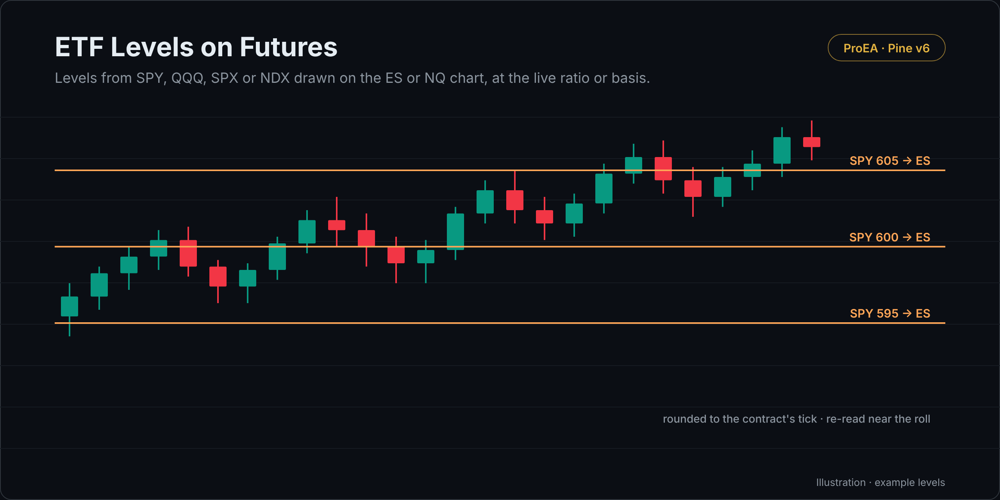

# ETF Levels on Futures

Levels you type in SPY, QQQ, SPX or NDX, drawn on the ES or NQ chart at the current ratio (for an ETF) or basis (for an index), rounded to the contract's tick.

## What it draws

- One line per level you type, labelled `level → futures price`.
- **Ratio (ETF):** level × futures close ÷ ETF close. **Basis (index):** level + futures close − index close.
- MES and MNQ trade at the same prices as ES and NQ, so the lines hold on the micros too.

## How it decides

- Live on purpose: the relation is read on the last bar, so it drifts through the day and jumps at the roll. Re-read it before a level matters.
- It reads the other symbol on the chart's own timeframe, with lookahead off.

## Settings

| Setting | Default | What it does |
|---|---|---|
| Levels are in | AMEX:SPY | The symbol your levels come from |
| Convert by | Ratio (ETF) | Ratio for an ETF, Basis for an index |
| Levels, comma-separated | 770, 765, 760 | Your levels |
| Color | orange |  |

## Alerts

None.

## Install

1. Copy [`etf-levels.pine`](etf-levels.pine). On GitHub, use **Copy raw file**.
2. On TradingView, open the **Pine Editor**, then **Open → New indicator**, select all, paste.
3. **Save**, then **Add to chart**.

## What it leaves out on purpose

Nothing to leave out: this is a utility.

## Related reading

- [SPY → ES and QQQ → NQ converter](https://proea.app/en/tools/spy-to-es-converter?utm_source=github&utm_medium=readme&utm_campaign=proea_indicators): the same arithmetic in the browser

---

[MPL-2.0](../../LICENSE) © ProEA · [All indicators](../../README.md)
