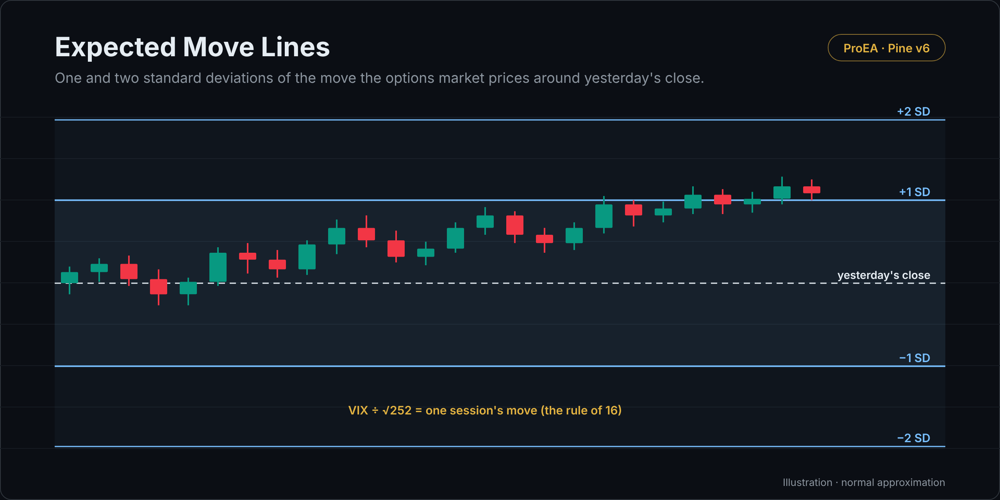

# Expected Move Lines

One and two standard deviations of the move the options market prices around yesterday's close, from the VIX (for the S&P 500: SPX, SPY, ES) or from an implied volatility you type.

## What it draws

- **One session's move** = yesterday's close × IV ÷ 100 × √(days ÷ 252). With the VIX as IV and one day, that's the
  "rule of 16": VIX ÷ √252 ≈ VIX ÷ 16 per cent.
- Lines at ±1 and ±2 standard deviations around yesterday's close.
- A normal approximation: about 68% of sessions inside one standard deviation and 95% inside two in theory. Real moves
  gap past two standard deviations more often than 5% of the time. Not a forecast.

## How it decides

- Yesterday's finished values: the VIX and the anchor close are requested with `close[1]` and `lookahead_on`, so the lines don't repaint.

## Settings

| Setting | Default | What it does |
|---|---|---|
| Volatility from | VIX (S&P 500) | VIX, or a typed IV for anything else |
| Typed IV (%) | 20 | The implied volatility of the expiry you trade |
| Trading days ahead | 1 | The horizon |
| Show 2 SD | on | The outer lines |

## Alerts

None.

## Install

1. Copy [`expected-move-lines.pine`](expected-move-lines.pine). On GitHub, use **Copy raw file**.
2. On TradingView, open the **Pine Editor**, then **Open → New indicator**, select all, paste.
3. **Save**, then **Add to chart**.

## What it leaves out on purpose

Nothing to leave out: this is a utility.

## Related reading

- [Expected move calculator](https://proea.app/en/tools/expected-move-calculator?utm_source=github&utm_medium=readme&utm_campaign=proea_indicators): the VIX, IV and straddle methods in the browser

---

[MPL-2.0](../../LICENSE) © ProEA · [All indicators](../../README.md)
