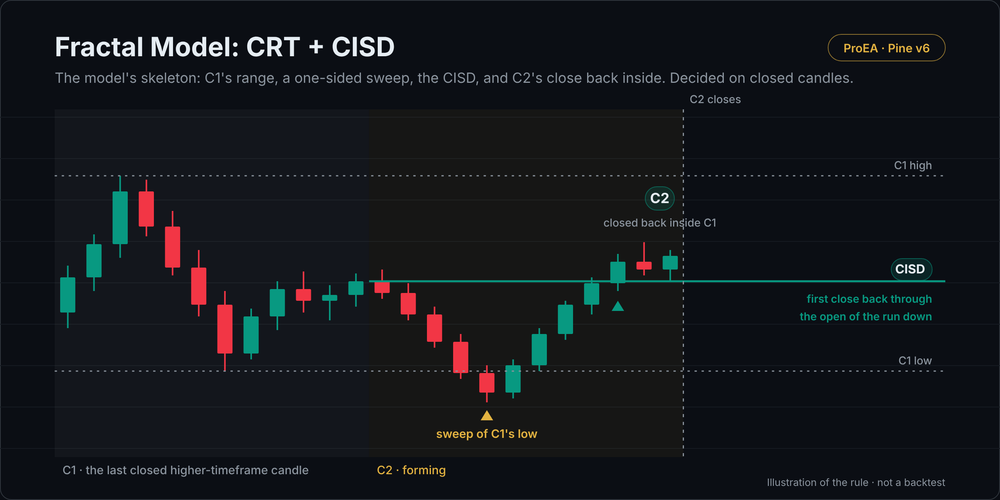

# Fractal Model: CRT + CISD

TTrades' Fractal Model skeleton on your chart, decided on closed candles. Its C2 rule is candle range theory (CRT): one higher-timeframe candle's range, swept on one side, closed back inside.

## What it draws

- **C1:** the last closed higher-timeframe candle. Its high and low are dotted while the next candle (C2) forms.
- **The sweep:** a triangle marks the first sweep of C1's low or high.
- **CISD:** after a sweep, the first chart close back through the open of the run of candles that made the swept
  extreme. A wick through it doesn't count. A deeper sweep moves the line to the run that made the new extreme.
- **C2:** when C2 closes, a label if it swept one side of C1 (not both) and closed strictly back inside C1's range.

**Higher timeframe, automatic:** 1m reads 15m, 5m reads 1H, 15m reads 4H, 1H reads 1D, 4H reads 1W, above that 1M. Turn
automatic off to choose your own; it must be above the chart's.

## How it decides

- Every mark is made on a closed chart candle, and marks don't move after the close.
- The higher-timeframe candles are requested with an offset of one candle (`[1]` with `lookahead_on`), so it never reads a candle that is still forming.

## Settings

| Setting | Default | What it does |
|---|---|---|
| Automatic higher timeframe | on | Picks C1's timeframe from the chart's, as listed above |
| Higher timeframe when automatic is off | 60 | Your own C1 timeframe |
| Show C1's high and low | on | The dotted range lines |
| Bullish / Bearish | teal / red | Colours |

## Alerts

Bullish CISD after C1's low was swept · Bearish CISD after C1's high was swept · C2 closed back inside C1 (bullish) · C2 closed back inside C1 (bearish)

## Install

1. Copy [`fractal-model.pine`](fractal-model.pine). On GitHub, use **Copy raw file**.
2. On TradingView, open the **Pine Editor**, then **Open → New indicator**, select all, paste.
3. **Save**, then **Add to chart**.

## What it leaves out on purpose

No bias, no point of interest, no entries or targets: the model's skeleton isn't an edge on its own. [Fractal Model Desk](https://proea.app/en/pine-library/fractal-model-desk?utm_source=github&utm_medium=readme&utm_campaign=proea_indicators) adds the delivery review (V reversal, displacement, decisive close), C3/C4 tracking, projections, history and audit, and the Strategy Lab. This script isn't a cut-down copy of the desk's code; it's the rule, written fresh.

## Related reading

- [The TTrades Fractal Model explained](https://proea.app/en/blog/ttrades-fractal-model?utm_source=github&utm_medium=readme&utm_campaign=proea_indicators)
- [Candle range theory (CRT)](https://proea.app/en/blog/candle-range-theory?utm_source=github&utm_medium=readme&utm_campaign=proea_indicators) · [Change in state of delivery (CISD)](https://proea.app/en/blog/change-in-state-of-delivery?utm_source=github&utm_medium=readme&utm_campaign=proea_indicators)
- [Fractal Model backtest: 108 versions on 7 markets](https://proea.app/en/blog/fractal-model-what-we-measured?utm_source=github&utm_medium=readme&utm_campaign=proea_indicators)
- [The most-boosted Fractal Model indicators, code-read](https://proea.app/en/blog/best-fractal-model-indicator-tradingview?utm_source=github&utm_medium=readme&utm_campaign=proea_indicators)

Not affiliated with TTrades.

---

[MPL-2.0](../../LICENSE) © ProEA · [All indicators](../../README.md)
