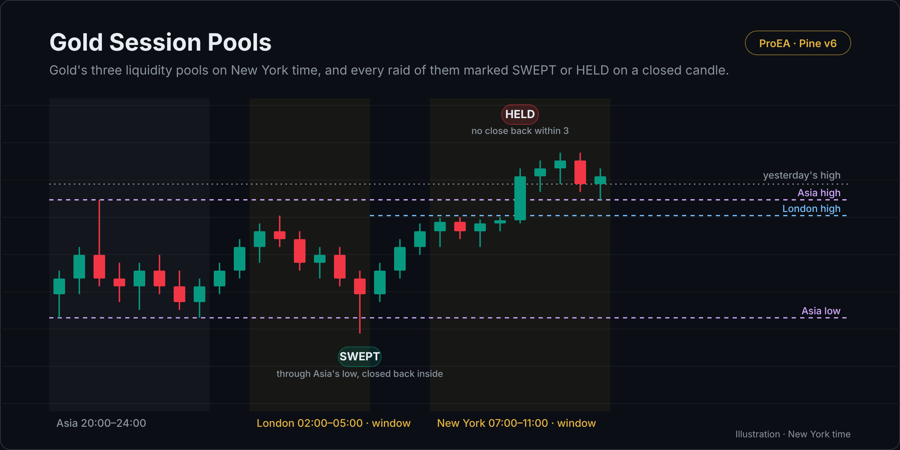

# Gold Session Pools

Gold's (XAUUSD) three liquidity pools on New York time, and every raid of them in the London or New York window marked SWEPT or HELD, decided on closed candles.

## What it draws

- **The pools:** yesterday's high and low (gold's day runs 18:00 to 17:00 New York), the Asia range (candles opening
  20:00 to 24:00, a pool from midnight) and the London range (02:00 to 05:00, a pool from 05:00). A pool is drawn until
  any candle trades through it.
- **A raid:** a closed candle in the London window (02:00 to 05:00) or the New York window (07:00 to 11:00) that trades
  at least 0.05 × ATR(14) through a fresh pool on one side only, measured from the outermost pool it takes. A candle that
  takes pools on both sides starts nothing. A later candle that takes a further pool on the same side moves the raid
  out to it.
- **SWEPT** when a close comes back inside on the raid candle or within the next three; **HELD** when it doesn't.
- Candles while spot gold is closed (Friday 17:00 to Sunday 18:00, and the daily 17:00 to 18:00 break) are skipped, so a
  spot chart and a 24-hour feed mark the same raids.
- Every time is New York time by the candle's open, whatever your chart's time zone, through daylight saving.

## How it decides

- Everything runs inside `barstate.isconfirmed`, so on closed candles only, on intraday charts of 1 hour or less.
- It reads no other timeframe. ATR(14) uses Wilder's smoothing over open-market candles only, so the closed hours don't move it.
- A SWEPT or HELD label is placed on the raid candle once the close back (or its absence) is known, up to three candles later.

## Settings

| Setting | Default | What it does |
|---|---|---|
| Sweep depth, ATR beyond the level | 0.05 | How far through a pool a raid must trade |
| Close back inside within, candles after the raid | 3 | SWEPT if a close returns inside by then |
| London window 02:00–05:00 / New York window 07:00–11:00 | on / on | Where raids count |
| Yesterday's high and low / Asia / London | on / on / on | Which pools to draw |
| Shade the windows | on | Window shading |
| Highs / Lows | red / teal | Colours |

## Alerts

Swept high · Swept low

## Install

1. Copy [`gold-session-pools.pine`](gold-session-pools.pine). On GitHub, use **Copy raw file**.
2. On TradingView, open the **Pine Editor**, then **Open → New indicator**, select all, paste.
3. **Save**, then **Add to chart**.

## What it leaves out on purpose

No entries, stops or targets, no signals to trade: a sweep is where liquidity was taken. [Gold Sweep Desk](https://proea.app/en/pine-library/gold-sweep-desk?utm_source=github&utm_medium=readme&utm_campaign=proea_indicators) adds the flip through the nearest opposing fair value gap, the plan (entry, stop, target, the 16:45 exit) and the record. It carries one setup at a time, so it skips raids while a setup is open, where this script marks them all. [Gold Sweep Desk Pro](https://proea.app/en/premium-vault/gold-sweep-desk?utm_source=github&utm_medium=readme&utm_campaign=proea_indicators) adds the game plan, context checks, SMT with silver and the 8-market Radar.

## Related reading

- [Gold liquidity sweep strategy: Asia, London, prior day](https://proea.app/en/blog/gold-liquidity-sweep-strategy?utm_source=github&utm_medium=readme&utm_campaign=proea_indicators)
- [Gold liquidity sweep backtest: two pre-registered studies](https://proea.app/en/blog/gold-sweep-desk-what-we-measured?utm_source=github&utm_medium=readme&utm_campaign=proea_indicators)
- [The most-boosted gold indicators](https://proea.app/en/blog/best-gold-indicator-tradingview?utm_source=github&utm_medium=readme&utm_campaign=proea_indicators) and [liquidity sweep indicators](https://proea.app/en/blog/best-liquidity-sweep-indicator-tradingview?utm_source=github&utm_medium=readme&utm_campaign=proea_indicators), code-read

---

[MPL-2.0](../../LICENSE) © ProEA · [All indicators](../../README.md)
