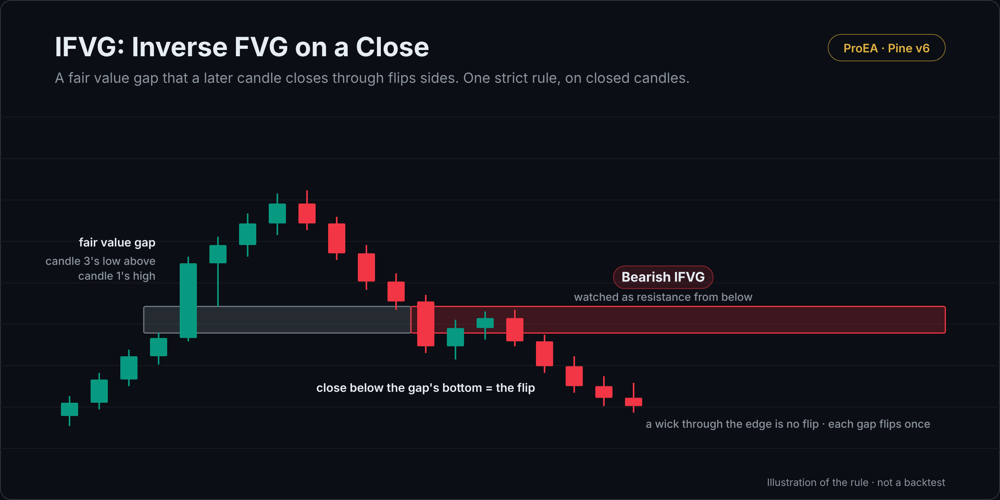

# IFVG: Inverse FVG on a Close

The inverse fair value gap (IFVG, inversion FVG) by one strict rule, decided on closed candles.

## What it draws

- **The gap:** candle 3's low strictly above candle 1's high (bullish), or its high strictly below candle 1's low
  (bearish), at least 0.05 × ATR(14) wide. Grey while it waits.
- **The flip:** a later candle closes strictly beyond the far edge. A bullish gap closed below its bottom becomes a
  bearish IFVG; a bearish gap closed above its top becomes a bullish IFVG. A wick through the edge, or a close exactly
  on it, is no flip.
- **The end:** a close strictly beyond the IFVG's other edge ends it. A gap still live 180 candles after it formed
  expires. Each gap flips once.

## How it decides

- Every decision is made on a closed candle, and the script reads no other timeframe.
- Nothing decided on a closed candle is changed later; a live gap's box only extends to the right.

## Settings

| Setting | Default | What it does |
|---|---|---|
| ATR length | 14 | The ATR the gap width is measured in |
| Smallest gap to keep, in ATR | 0.05 | Narrower gaps are ignored |
| A gap still live after this many candles expires | 180 | Age limit |
| Most gaps kept on the chart | 40 | Older ones are removed (up to 100) |
| Colours | grey / teal / red | Waiting gap, bullish IFVG, bearish IFVG |

## Alerts

Bullish IFVG · Bearish IFVG

## Install

1. Copy [`ifvg.pine`](ifvg.pine). On GitHub, use **Copy raw file**.
2. On TradingView, open the **Pine Editor**, then **Open → New indicator**, select all, paste.
3. **Save**, then **Add to chart**.

## What it leaves out on purpose

No entries, stops or targets: an inverted gap is a zone, not a signal. [IFVG Desk](https://proea.app/en/pine-library/ifvg-desk?utm_source=github&utm_medium=readme&utm_campaign=proea_indicators) adds the entry model (inversion close or retest), the New York window, the optional checks (higher-timeframe gap, sweep, SMT, prior-day bias, displacement), the stop, target and size, the setup history and the strategy companion.

## Related reading

- [Inverse fair value gap: the rule and the strategy](https://proea.app/en/blog/inverse-fair-value-gap?utm_source=github&utm_medium=readme&utm_campaign=proea_indicators)
- [The most-boosted IFVG indicators, code-read](https://proea.app/en/blog/best-ifvg-indicator-tradingview?utm_source=github&utm_medium=readme&utm_campaign=proea_indicators)

---

[MPL-2.0](../../LICENSE) © ProEA · [All indicators](../../README.md)
