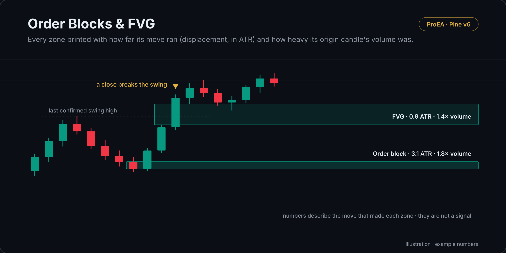

# Order Blocks & FVG

Smart money concepts order blocks and fair value gaps, decided on closed candles, each printed with two numbers: how far the move that made it ran (displacement, in ATR) and how heavy its origin candle's volume was (volume ratio).

## What it draws

- **Order block:** a candle closes strictly beyond the last confirmed swing high or low (15 candles on each side). The
  last opposite-colour candle in the 20 before that close is the block; the zone is its body. A wick beyond the swing is
  no break, and each swing is broken once.
- **Fair value gap:** candle 3's low strictly above candle 1's high (bullish), or its high strictly below candle 1's low
  (bearish), at least 0.25 × ATR(14) wide.
- **Displacement:** for an order block, the distance from the block's far edge to the close that broke the swing; for a
  gap, the body of its middle candle. Both divided by ATR(14) on the candle that made the zone.
- **Volume ratio:** the origin candle's volume over its 20-candle average (the block's candle, or the gap's middle
  candle). `n/a` when the symbol has no volume data.
- **The end:** a close strictly beyond a zone's far edge ends it, and it turns grey. A zone still live 500 candles after
  it formed stops too. The latest 60 zones are kept (a setting, up to 150).

## How it decides

- Every decision is made on a closed candle, and the script reads no other timeframe.
- A swing is confirmed only 15 candles after it, so a break is measured against swings already confirmed.
- Nothing decided on a closed candle is redrawn later, apart from the zone cap; a live zone's box only extends to the right.

## Settings

| Setting | Default | What it does |
|---|---|---|
| Swing length | 15 | Candles on each side of a swing |
| Order block: candles to look back from the break | 20 | Where the last opposite candle is searched |
| ATR length | 14 | Displacement and the gap filter are in this ATR |
| Smallest fair value gap, in ATR | 0.25 | Narrower gaps are ignored |
| Volume average length | 20 | The volume ratio's baseline |
| A zone still live after this many candles stops | 500 | Age limit |
| Most zones kept on the chart | 60 | Up to 150 |
| Order blocks / Fair value gaps | on / on | Which zones to draw |
| Print displacement and volume on each zone | on | The two numbers |
| Colours | teal / red / grey | Bullish, bearish, ended |

## Alerts

Bullish order block · Bearish order block · Bullish fair value gap · Bearish fair value gap

## Install

1. Copy [`order-blocks-fvg.pine`](order-blocks-fvg.pine). On GitHub, use **Copy raw file**.
2. On TradingView, open the **Pine Editor**, then **Open → New indicator**, select all, paste.
3. **Save**, then **Add to chart**.

## What it leaves out on purpose

No score or rating, no entries, stops or targets, and it doesn't track how zones turned out. A bigger number describes the move that made the zone; it isn't a signal. The [SMC AI-Scored Toolkit](https://proea.app/en/indicators/smc?utm_source=github&utm_medium=readme&utm_campaign=proea_indicators) adds the 0–100 score with regime weights, the sweep, higher-timeframe and time-of-day factors, resolution tracking (respected, failed, expired) and the trade-plan ticket.

## Related reading

- [Do order blocks work? 1,729 zones backtested](https://proea.app/en/blog/smc-zone-score-study?utm_source=github&utm_medium=readme&utm_campaign=proea_indicators)
- [The most-boosted SMC indicators, code-read](https://proea.app/en/blog/best-smc-indicator-tradingview?utm_source=github&utm_medium=readme&utm_campaign=proea_indicators)

---

[MPL-2.0](../../LICENSE) © ProEA · [All indicators](../../README.md)
