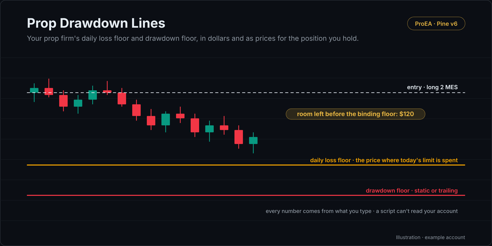

# Prop Drawdown Lines

Your prop firm's daily loss floor and drawdown floor in dollars, and, for one open position, as price lines on the chart. Every number comes from what you type: a TradingView script can't read your account.

## What it draws

- **Daily floor:** today's starting balance − your daily loss limit.
- **Drawdown floor:** static = account size − max drawdown. Trailing = the highest balance you type − max drawdown,
  never under the static floor and never above the lock you set (for example the starting balance + $100).
- **The higher of the two binds.** A line is where the position's loss takes your balance before the trade to that
  floor; touching it counts as a breach.
- For a trailing floor, type the high your firm trails from: the highest close for an end-of-day trail, the highest
  equity for an intraday one. The script doesn't raise the floor while the trade runs.

Set **Dollars per 1.0 move** to your contract's value per point (ES 50, MES 5, NQ 20, MNQ 2) or your broker's value for
other markets.

## How it decides

- Live on purpose: it warns on the live candle, because a floor touched intrabar can end an account.
- Your firm's dashboard is the source of truth. Its rulebook decides the floor type, the lock and when the day starts.

## Settings

| Setting | Default | What it does |
|---|---|---|
| Account size ($) | 50,000 | Your account's size |
| Max drawdown ($) | 2,000 | The firm's maximum loss |
| Drawdown type | Static | Static or Trailing |
| Highest balance so far ($) | 0 = account size | The high a trailing floor follows |
| Trailing floor stops at ($) | 0 = no lock | The lock |
| Daily loss limit ($) | 1,000 | 0 = none |
| Today's starting balance ($) | 0 = account size | The daily floor's base |
| Balance before this trade ($) | 0 = today's start |  |
| Open position / Entry price / Size | None / 0 / 1 | Long or short, and how many units |
| Dollars per 1.0 move in price, per unit | 50 | ES 50, MES 5, NQ 20, MNQ 2 |
| Warn when the room left is under ($) | 250 | The warning alert's threshold |

## Alerts

Floor touched (the bar's worst price touched the binding floor) · Floor near (the room left fell under your warning amount). Each fires on the bar where it starts, not again while it stays true.

## Install

1. Copy [`prop-drawdown-lines.pine`](prop-drawdown-lines.pine). On GitHub, use **Copy raw file**.
2. On TradingView, open the **Pine Editor**, then **Open → New indicator**, select all, paste.
3. **Save**, then **Add to chart**.

## What it leaves out on purpose

Firm presets, the verdict (ON TRACK, AT RISK, FAILED) and the health score, the profit target and dashboard, and several positions are the [Prop Firm Challenge Toolkit](https://proea.app/en/indicators/prop?utm_source=github&utm_medium=readme&utm_campaign=proea_indicators)'s job.

## Related reading

- [EOD vs intraday trailing drawdown](https://proea.app/en/blog/eod-vs-intraday-trailing-drawdown?utm_source=github&utm_medium=readme&utm_campaign=proea_indicators)
- [Prop firm drawdown calculator](https://proea.app/en/tools/prop-firm-drawdown-calculator?utm_source=github&utm_medium=readme&utm_campaign=proea_indicators)
- [The most-boosted prop firm indicators, code-read](https://proea.app/en/blog/best-prop-firm-indicator-tradingview?utm_source=github&utm_medium=readme&utm_campaign=proea_indicators)

---

[MPL-2.0](../../LICENSE) © ProEA · [All indicators](../../README.md)
